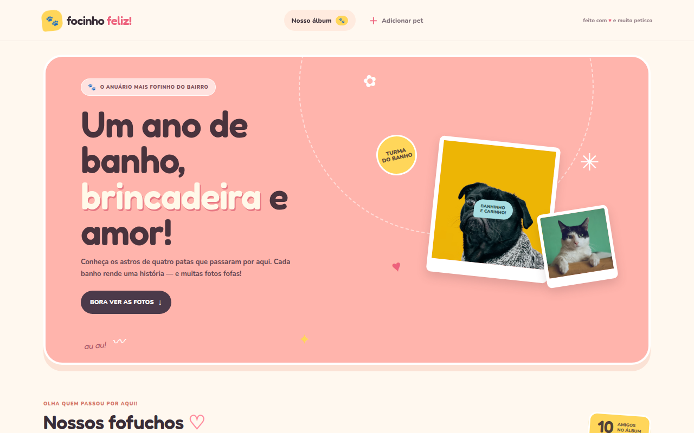

<div align="center">

# Focinho Feliz — Álbum de Pets

Aplicação web para cadastro de pets e registro fotográfico das visitas, com histórico organizado por data.




</div>

---

## Funcionalidades

- **Cadastro de pets** com nome, espécie, raça (dropdown conforme a espécie), responsável e data de nascimento.
- **Álbum de fotos** por pet, organizado por data, com **foto principal** escolhida pelo tutor.
- **Imagens no Google Cloud Storage**: o banco guarda apenas os metadados e a URL pública.
- **Busca e filtro** por espécie no álbum.
- **API documentada com Swagger**: Swagger UI em `http://localhost:3333/docs`.

## Telas

| Álbum | Detalhes do pet |
|:---:|:---:|
|  |  |

| Cadastro |
|:---:|
|  |

## Arquitetura

```
┌──────────────┐   REST + JSON   ┌───────────────┐        ┌──────────────┐
│   Frontend   │ ──────────────▶ │    Backend    │ ─────▶ │  PostgreSQL  │
│  Next.js 16  │                 │ Express+Prisma│        │  (metadados) │
└──────────────┘                 └───────┬───────┘        └──────────────┘
                                         │
                                         ▼
                                 ┌───────────────┐
                                 │ Google Cloud  │
                                 │   Storage     │
                                 │  (imagens)    │
                                 └───────────────┘
```

## Estrutura do repositório

```
.
├── backend/    API Node.js + Express + Prisma + PostgreSQL   → veja backend/README.md
├── frontend/   Interface em Next.js + React                  → veja frontend/README.md
└── docs/       Imagens usadas nos READMEs
```

## Como rodar (resumo)

> Pré-requisitos: **Node.js 20+**, **npm** e, para o backend real, **PostgreSQL** e uma **conta de serviço do Google Cloud** com acesso ao bucket.

### Frontend + backend

**Terminal 1 — backend** (porta `3333`):

```bash
cd backend
npm install
cp .env.example .env        # edite com seus dados
npm run generate
npm run migrate
npm run seed                # opcional: pets de exemplo
npm run dev
```

**Terminal 2 — frontend** (porta `3000`):

```bash
cd frontend
npm install
echo "NEXT_PUBLIC_API_URL=http://localhost:3333" > .env.local
npm run dev
```

Abra <http://localhost:3000>.

## Portas padrão

| Serviço | Porta |
|---|---|
| Frontend (Next.js) | `3000` |
| Backend (Express) | `3333` |
| PostgreSQL | a definida na `DATABASE_URL` |

## Documentação detalhada

- [Backend — API, variáveis de ambiente, endpoints e modelo de dados](backend/README.md)
- [Frontend — scripts, integração com a API e estrutura](frontend/README.md)

## Segurança

`.env` e a pasta `credentials/` (JSON da Service Account) estão no `.gitignore`. **Nunca** envie credenciais para o Git.

---

## Integrantes

- Gabriel da Silveira Pessoni
- Lívia Portela Ferreira
