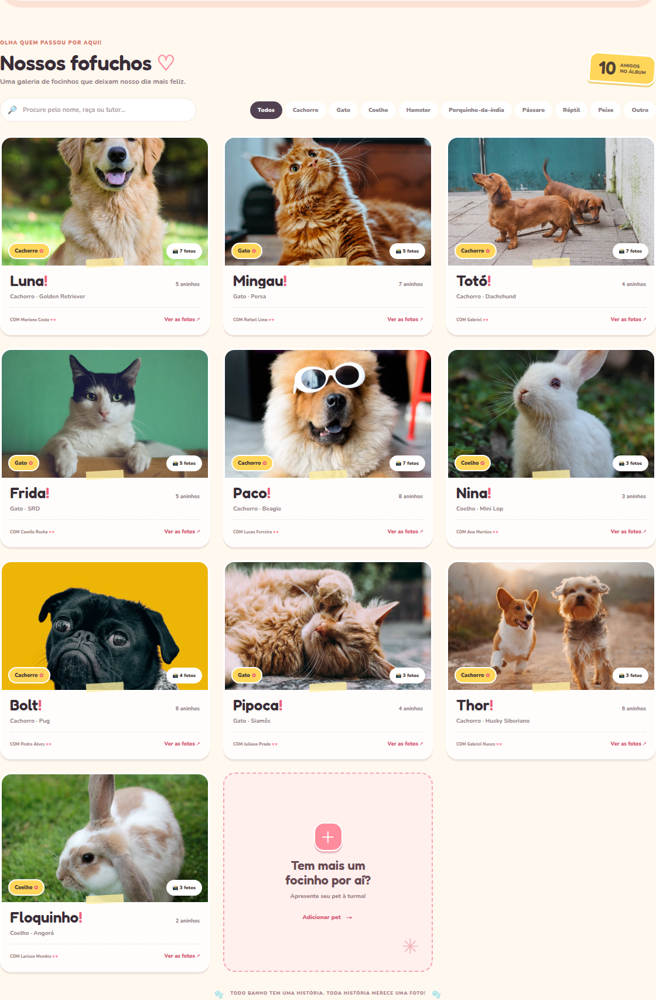
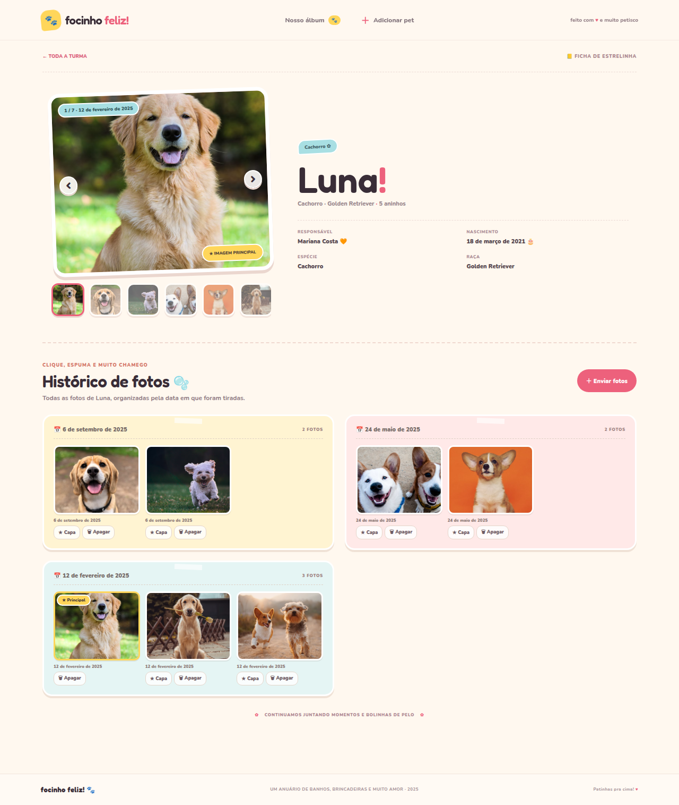
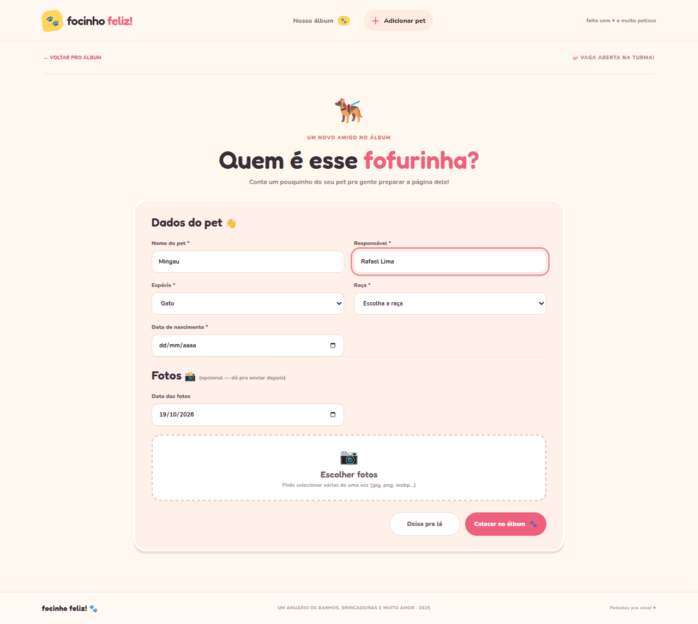

# 🎨 Frontend — Focinho Feliz

Interface do álbum de pets em **Next.js 16 + React 19**, feita sem bibliotecas de UI: só React e CSS.




## 📑 Sumário

- [Telas](#-telas)
- [Como rodar](#-como-rodar)
- [Conexão com o backend](#-conexão-com-o-backend)
- [Scripts](#-scripts)
- [Estrutura de pastas](#-estrutura-de-pastas)
- [Contrato com a API](#-contrato-com-a-api)

## 🖼️ Telas

| Detalhes do pet | Cadastro |
|:---:|:---:|
|  |  |

- **Álbum:** cards com foto principal e contador de fotos, busca por texto e filtro por espécie.
- **Detalhes:** perfil do pet, galeria, histórico fotográfico por data, envio de novas fotos, escolha da foto principal e exclusão.
- **Cadastro:** dados do pet, com **raça em dropdown conforme a espécie**, e envio opcional de fotos já no cadastro.

## 🚀 Como rodar

Pré-requisitos: **Node.js 20+** e npm.

```bash
npm install
npm run dev
```

Abra <http://localhost:3000>.

## 🔌 Conexão com o backend

O frontend precisa do backend rodando. Por padrão ele usa `http://localhost:3333`.

1. Suba o backend (porta `3333`) — veja o [README do backend](../backend/README.md).
2. Para usar outra URL, crie o arquivo `frontend/.env.local`:

   ```env
   NEXT_PUBLIC_API_URL=http://localhost:3333
   ```

3. **Reinicie** o `npm run dev` (o Next.js só lê variáveis de ambiente na inicialização).

> O `.env.local` é ignorado pelo Git.

## 📜 Scripts

| Comando | O que faz |
|---|---|
| `npm run dev` | Servidor de desenvolvimento (porta 3000) |
| `npm run build` | Build de produção |
| `npm start` | Serve o build de produção |

Para usar outra porta: `npm run dev -- -p 3001`.

## 📁 Estrutura de pastas

```
frontend/
├── app/
│   ├── layout.jsx           layout raiz e metadados
│   └── page.jsx             navegação entre álbum, cadastro e detalhes
├── components/
│   ├── Album.jsx            lista, busca e filtro
│   ├── PetCard.jsx          card do pet
│   ├── PetForm.jsx          cadastro (raça por espécie)
│   ├── PetDetails.jsx       página do pet
│   ├── PetGallery.jsx       galeria de fotos
│   ├── PhotoHistory.jsx     histórico por data
│   ├── PhotoPicker.jsx      seleção de arquivos
│   ├── Photos.jsx           lightbox e itens de foto
│   ├── Layout.jsx           cabeçalho, rodapé e estados de carregamento
│   └── Field.jsx            campo de formulário
├── hooks/useLoad.js         carregamento de dados com erro e recarga
├── lib/
│   ├── api.js               chamadas HTTP ao backend
│   ├── pets.js              espécies, raças e ordenação de fotos
│   ├── format.js            datas, idade e plural
│   └── utils.js
└── styles.css               estilos globais
```

## 🔌 Contrato com a API

O frontend usa os mesmos nomes de campos que o backend devolve, sem conversão no meio:

```
Pet (listagem)  { id, nome, especie, raca, responsavel, dataNascimento, fotoPrincipalUrl, totalFotos }
Pet (detalhe)   { ...Pet, fotos: Foto[] }
Foto            { id, url, dataFoto, principal }
```

O backend responde com `{ sucesso, dados }` (ou `{ sucesso: false, erro }`) e todas as chamadas ficam em [`lib/api.js`](lib/api.js). As datas chegam em ISO e são reduzidas a `AAAA-MM-DD` por `apenasData` em [`lib/format.js`](lib/format.js).

### Adicionando espécies e raças

Edite o objeto `BREEDS` em [`lib/pets.js`](lib/pets.js). Cada chave é uma espécie e o valor é a lista de raças do dropdown. A espécie **Outro** usa campo de texto livre.
